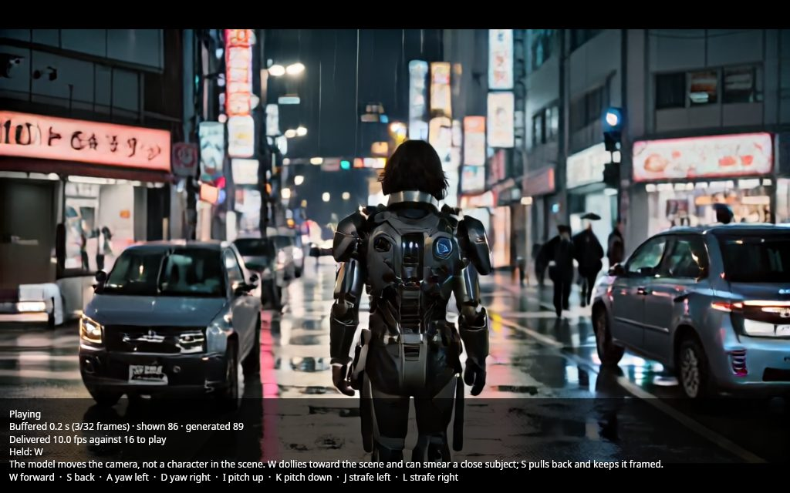
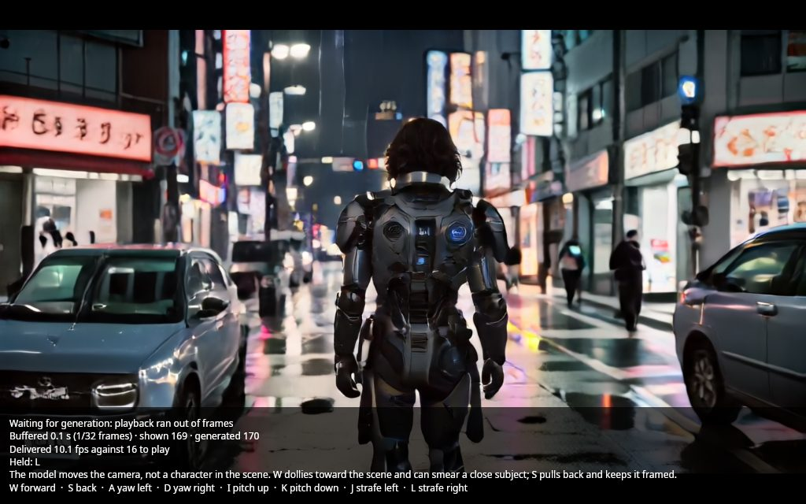

# World live viewer: design, and how to add a control scheme

`hartsy world --view` opens a window that plays a world model's frames as the session generates them and steers the run from
the keyboard. Hold a key to move; release it to stop. The run still writes its PNGs and MP4 exactly as before. Esc or Q, or
closing the window, ends the run the way `q` does, so what was generated is saved.

**What the model moves is the camera, not the character.** On SANA-WM the keys move the camera through the scene. `w` dollies
toward whatever is ahead, which smears a close subject within a few dozen frames, and `s` pulls back and keeps the subject
framed. For a third-person view, start from a seed still framed from behind the character, looking down the street. Do not
expect the character to respond to the keys.

## Layers

| Layer | Project | Owns |
|---|---|---|
| Control schemes | `HartsyInference.Engine` (`Worlds/`) | `IWorldControlScheme`, the built-in schemes for SANA-WM, Oasis and DIAMOND, and `WorldCapabilities.LiveControls` |
| Core | `HartsyInference.WorldViewer` | `WorldSteering` (held keys to session actions), `WorldFrameStream` (per-step feeding), `WorldRunPump` (frames to the spool and the window, and when the window closes), `WorldPlayback` and `WorldPacer` (bounded buffer and frame clock), `WorldPlaybackText` (status text), `IWorldWindow` (the window's contract) |
| Window | `HartsyInference.WorldViewer.Avalonia` | `WorldViewerHost` (Avalonia on its own UI thread; implements `IWorldWindow`) and `WorldViewerWindow` (frames, keys, status block) |

The core depends only on `IWorldSession`, the frame rate and the frame size. It has no window toolkit, so a web or remote front
end can reuse it; an HTTP client for `/v1/native/world/sessions/{id}/stream` is not built yet. Only the window project references
Avalonia, pinned to 11.3.22, the version in the local NuGet cache.

The CLI keeps its frame path: `WorldAsync` hands each frame to `WorldRunPump`, which writes it to the spool (PNGs, then the MP4 on
quit) and, with `--view`, to the playback buffer. The spool's PNG encoding runs on background writers, so the stream does not wait
for it. Without `--view` the same path runs with no window.

## Cadence: how keys become actions

A control scheme declares how its session takes actions:

- **`OnChange`** (SANA-WM streaming). The held key set is sent when it changes, and the session applies it to every later
  chunk. Holding `w` sends one action; auto-repeat changes nothing.
- **`PerStep`** (Oasis, DIAMOND). A session that ends whenever its action queue drains needs one action per step. The stream sends
  the current held action before each step and asks again. Oasis re-seeds each step from its last frame, so control lags by one
  generated frame; DIAMOND renders one frame per action. Both stop after `--frames` frames under `--view`, since neither can run
  unbounded; the window stays open to show them.

Only keys the scheme declares are tracked. The window reports key names as they are pressed (`W`, `Space`, `LeftShift`, `Up`).

## Pacing and lag

Frames are played at the plan's frame rate. Playback starts after one second of frames (or the whole buffer if smaller), and a
rebuffer after an underrun resumes at a quarter second. A chunked stream buffers two seconds of video. A per-step stream buffers two
frames, because its buffer is its control lag. When the buffer is full the stream waits, so generation is held back rather than
letting control lag grow. The window shows the buffered seconds, the frames shown and generated, and the delivered frame rate
against the play rate. The delivered rate is measured up to the end of the stream, so a window left open after the run keeps the
run's figure. The brief asked for generation time per chunk; the first live run showed that a wait measured on the consumer side
reads zero whenever the buffer absorbs the generation, so the window reports the delivered rate instead, and the breakdown below
gives the per-stage times. When the delivered rate is below the play rate, the buffer drains and the window says it is waiting for
generation.

A key press reaches the picture after the buffered video plays out and the next chunk generates: at most the buffer plus one
chunk's generation time. On SANA-WM streaming a chunk is 24 frames, 1.5 seconds of video at 16 fps. Before the speed pass the
RTX 4090 delivered about 9 frames per second on this seed, because PNG encoding on the consumer thread set the pace; after it, about
14 frames per second, which is the model's own pace (see below). Either way the window says when it is waiting for generation.

## Where the time goes

Measured on the RTX 4090 (`CUDA_VISIBLE_DEVICES=0`, under the GPU lock), `sana-wm-streaming`, seed 42, 193 frames (8 chunks), with
the keys `w`, `a`, `l` pressed in turn. The timers are wall-clock totals per event, collected by `WorldStageTimings` and printed at the
end of every `--view` run. Chunk stages are per chunk, consumer stages per frame, as the means of the run. The first chunk includes
warm-up, so the per-chunk means sit above the steady rate.

| Stage | Before | After |
|---|---|---|
| Model sample: denoise and state write (per chunk) | 1031 ms | 1023 ms |
| VAE decode (per chunk) | 984 ms | 924 ms |
| Float to RGB24 conversion (per chunk) | 231 ms | 254 ms |
| Producer waiting for the consumer (per chunk) | 646 ms | 0.2 ms |
| Consumer handing a frame to the spool (per frame) | 113 ms | 0.0 ms |
| of which PNG encode, summed over writer threads (per frame) | 110 ms | 111 ms |
| Consumer waiting for the next frame (per frame) | 88 ms | 150 ms |
| Window draw, UI thread (per frame) | 5.0 ms | 4.7 ms |
| MP4 mux (once) | 3.4 s | 3.1 s |
| Delivered frames per second, first to last frame file | 8.9 | 14.3 |

The last row is the delivered rate, measured from the PNG file times for the same keys and frame count; the no-key runs give 9.1
and 14.4. The window's own figure is the same quantity measured from the window's clock; it read 11.3 on the after run
before the clock was frozen at the end of the run, so the table uses the file times.

Before the change the consumer encoded each frame before it took the next, so a 24-frame chunk spent about 2.7 seconds in PNG
encoding while the model waited (646 ms per chunk). After it, four background writers encode in parallel behind a queue of 32
frames, the consumer hands each frame off in microseconds, and the stream runs at the model's pace. What remains is model time: the
sample and VAE decode are about 2 seconds of each chunk, so the model, not the viewer, sets the rate on this seed. The VAE decode is
the largest cost after the denoise steps. Neither was changed here, since the brief keeps the model and its kernels out of this PR.

Candidates for the model side, not done: the VAE decode (about 0.9 s per chunk, a half-precision decode or fused kernels), and the
denoise steps (about 1.0 s per chunk). The float-to-RGB conversion (about 0.25 s per chunk) could fan out across frames, but reading
the same tensor's span from several threads raised an access violation in the first attempt, so it stays serial until that read is
made safe.

The output is unchanged: the 193 frame PNGs and the MP4 of the after run are byte-identical to the before run (matching SHA-256
digests of the sorted frame files and of the MP4). Memory is flat over a 1009-frame unbounded run: the resident set's median was
10.56 GB in the first quarter and 10.65 GB in the last, a 1% rise, with the writer queue capped at 32 frames.

## Limits, stated plainly

- Oasis batches each step: a key change reaches the picture a frame later, and the model sees only the last frame, not its
  history.
- DIAMOND's picture moves at the model's pace, not the frame rate.
- `--view` and `--interactive` cannot be combined. `--actions` is refused with `--view` for a per-step model; steer it with the keys.
- A per-step model under `--view` stops after `--frames` frames, since Oasis and DIAMOND cannot run unbounded.
- Avalonia on macOS wants the process's main thread, and the window runs on its own thread. Only Linux (X11 or Wayland) has been
  run here; Windows and macOS are unverified.
- A batch model with no live control (SANA-WM stage 1) plays its clip when the run completes, and the window says so.

## Adding a control scheme for a new world model

A new model adds a scheme and nothing else; the viewer reads the scheme from the catalog and never names a model.

1. Add a class in `src/HartsyInference.Engine/Worlds/` that implements `IWorldControlScheme`: a `Name`, the `Cadence`, the
   `Controls` list (key name and label for the legend), a one-line `Note`, and `ActionFor(heldKeys)`, which returns the action
   string the session takes. Pick `OnChange` if the session holds the last action, `PerStep` if it consumes one action per step.
   Expose it as a shared `Instance` the way `SanaWmControlScheme` does.
2. Declare it on the model's `WorldCapabilities` in `ModelCatalog`: `LiveControls = YourScheme.Instance`. Models without live
   control leave it null.
3. Test the mapping in `tests/HartsyInference.Engine.Tests/Worlds/WorldControlSchemeTests.cs`. Check every action string
   against the model's own action parser (for SANA-WM, `SanaWmAction.ParseKeys`), not only against a string you wrote.

Esc and Q are reserved for stopping a run; a scheme must not declare them. Key names compare case-insensitively.

## Running it

```bash
hartsy world -m sana-wm-streaming --model-path <dit.safetensors> --image <seed.png> \
    --prompt "<prompt>" --intrinsics 800,800,640,352 --actions "s-24" --unbounded --view -o <outdir>
```

The window needs a display (`DISPLAY` or `WAYLAND_DISPLAY`); without one, `--view` fails before the model loads. The window takes
keys only while it has focus, so click it after it opens. Esc or Q, or closing the window, ends the run.

## Tests

- `tests/HartsyInference.WorldViewer.Tests`: steering, pacer, playback buffer, frame stream with a scripted session (chunk
  bursts, a failing stream, cancellation, per-step re-enumeration), and the status text. No GPU, no window.
- `tests/HartsyInference.WorldViewer.Avalonia.Tests`: headless Avalonia. Key down and up through the window reach the steering,
  Esc requests the stop once, and an undeclared key changes nothing.
- `tests/HartsyInference.Engine.Tests/Worlds/WorldControlSchemeTests.cs`: key mapping for the three schemes, and the catalog's
  declarations.

## Evidence

Two live runs on the RTX 4090 (`CUDA_VISIBLE_DEVICES=0`, the 4090 under the default device order), both under the GPU lock,
both `sana-wm-streaming --unbounded --view` with the seed still framed from behind the character and the opening script `s-24`:

- Run 1: keys `w` (3 s), `a` (2 s) and `l` (2 s) sent with real X key events. The window showed the live frames, `Held` changed
  with each key, Esc stopped the run, and the CLI wrote 560 PNGs and an MP4 of 35.0 s at 16 fps, 1280x704. The process exited 0.
- Run 2, the same command: keys `w`, `a` and `l` again, with screenshots taken while each key was held. The HUD read `Held: W`
  and `Held: L` at those moments. The stream delivered about 10 frames per second against 16 to play, so the buffer ran down to
  a tenth of a second and the window showed "Waiting for generation". The run wrote 223 PNGs and a 13.9 s MP4, and Esc stopped it.





Those figures say the plumbing works: the key state reaches the window, the actions reach the session, and the playback and
spool agree. They were taken before the speed pass, when the 4090 delivered about 9 frames per second against the 16 it plays at.
The speed-pass runs are in the table above: about 14 frames per second, with the same frames and the MP4 unchanged. The seed still
runs slower than real time on the 4090 even so; the model's own pace is the limit now.
